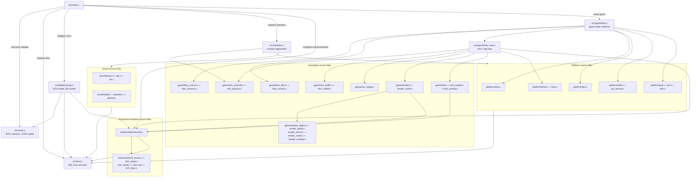

# C source files and dependencies

In C, `.c` files are usually called **source files** or **translation units**.
Each is compiled separately into an object file and then linked into the
executable. They are not classes, and calling them “scripts” would be unusual
for compiled C code.

The diagram below is a simplified **logical/runtime dependency map** of the
main source files, not a complete `#include` graph or function call graph.
Arrows show major startup, ownership, or runtime relationships. C modules
generally share declarations through headers (`game/game.h`,
`platform/platform.h`, `host.h`, etc.); one `.c` file does not normally
`#include` another `.c` file. CMake compiles the source files together into
`testdrive3-enhanced`.

The broad boxes group related `.c` files to keep the graph readable. They do
not mean those files are a single compilation unit. For a strict dependency
audit, inspect the `#include` directives and function declarations in the
source and headers; a header dependency alone does not mean every function in
that header is called.
